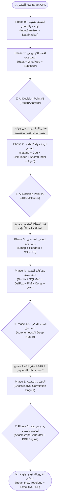
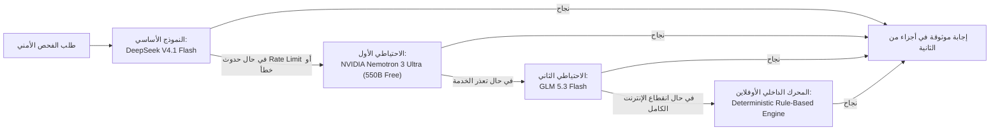

# 🛡️ Orion Security Platform — دليل معمارية الذكاء الاصطناعي والتكامل الهجين مع أدوات الفحص
## Complete Architecture Guide: AI Roles, Tool Synergy, and Hybrid Pipeline Flow

> **الغرض من الوثيقة**: شرح المعمارية الهجينة لمنصة **Orion** (أدوات الفحص المتخصصة + محركات الذكاء الاصطناعي التوليدية والتحليلية)، وبيان دور الـ AI في توجيه كل أداة من الأدوات الـ 19، ومخطط سير العمليات (Pipeline Flow)، وكيفية التغلب على قيود أدوات الفحص التقليدية.

---

## 1. الفلسفة الأساسية: لماذا المعمارية الهجينة (Hybrid Paradigm)؟

في عالم الأمن السيبراني واختبار الاختراق، يعاني أي نهج أحادي من قصور خطير:

```
[الأدوات التقليدية وحدها] = سرعة فائقة + قوة حسابية + غباء سياقي (Context-Blind) وعجز عن فهم منطق التطبيق (Logic Flaws).
[الذكاء الاصطناعي وحده] = ذكاء سياقي وفهم للمنطق + بطء شديد وعجز عن فحص 50,000 مسار أو إرسال حزم Raw SYN للشبكة.
─────────────────────────────────────────────────────────────────────────────
[منصة Orion الهجينة]   = قوة وسرعة الأدوات المتخصصة × ذكاء وتحليل وبصيرة الـ AI Reasoning Engine.
```

> [!IMPORTANT]
> الذكاء الاصطناعي في منصة Orion **لا يستبدل الأدوات المتخصصة**، بل يعمل بمثابة **قائد الفريق (Team Lead & Lead Pentester)** الذي يحلل المدخلات، ويوجه كل أداة للمكان الصحيح، ثم يستلم النتائج ويفكك الروابط المعقدة بينها ليكتشف ما عجزت عنه الأدوات.

---

## 2. مخطط سير العمليات الشامل (Master Hybrid Pipeline Flowchart)

يوضح المخطط التالي دورة حياة الفحص الأمني عبر المراحل الخمس وكيف يتدخل الذكاء الاصطناعي في نقاط القرار التكتيكية (AI Decision Points):



---

## 3. نقاط القرار الخمس للذكاء الاصطناعي (The 5 AI Strategic Modules)

### 🧠 نقطة القرار الأولى: محلل الاستطلاع والمكدس (`ReconAnalyzer`)
- **المرحلة**: نهاية Phase 1.
- **المدخلات**: السيرفر، إصدار الـ CMS، التقنيات المكتشفة (مثل ASP.NET, PHP, Nginx, IIS).
- **التأثير على الأدوات**:
  - يحدد لـ `Katana` و `ffuf` مسارات الزحف ذات الأولوية بناءً على التقنية (مثلاً إذا كان الهدف ASP.NET، يوجه الزاحف للبحث عن `.aspx`, `web.config`, `trace.axd`).
  - يقترح كلمات مفتاحية مخصصة (Custom Wordlists) لأدوات التخمين.

---

### 🧠 نقطة القرار الثانية: مخطط مسارات الهجوم (`AttackPlanner`)
- **المرحلة**: نهاية Phase 2 وقبل Phase 4.
- **المدخلات**: آلاف الروابط والـ Forms والباراميترات المكتشفة بواسطة `Katana` و `Gau` و `Arjun`.
- **التأثير على الأدوات**:
  - يمنع التشغيل العشوائي للأدوات على الروابط غير المصابة.
  - يستخرج الروابط ذات معاملات قواعد البيانات (`id`, `query`, `cat`) ويرسلها لـ `SQLMap`.
  - يستخرج حقول الإدخال والـ Forms ويرسلها لـ `DalFox` لفحص XSS.
  - يحدد وسوم ثغرات الـ CVE المناسبة لـ `Nuclei` لتوفير وقت الفحص وتجنب حظر الـ IP.
  - يفحص التوكنات لاكتشاف الـ JWT وتوجيه أداة `jwt_tool`.

---

### 🧠 الصياد الذكي المستقل (`AIDeepHunter`)
- **المرحلة**: Phase 4.5 (ميزة حصرية للخطط المتقدمة - ميزانية 5 دقائق).
- **المدخلات**: الروابط والـ Endpoints الحقيقية والملفات المكتشفة.
- **الدور الفعلي**:
  - **يعمل كمختبر اختراق بشري (Human Penetration Tester)**: لا ينتظر النتائج الجاهزة، بل يأخذ الروابط التي وجدها الزاحف ويقوم بحقن بيلودات ذكية.
  - يكشف ثغرات انهيار الاستجابة (Crash Differentials) التي تدل على SQL Injection خفية.
  - يكتشف ثغرات الصلاحيات (IDOR) بتجربة أرقام متسلسلة ومقارنة البيانات المسترجعة وسياقها.
  - يكتشف ثغرات تضمين الملفات والـ Path Traversal على باراميترات الملفات (`NewsAd`, `file`, `page`).

---

### 🧠 نقطة القرار الثالثة: المحلل الشبح (`GhostAnalyst`)
- **المرحلة**: Phase 5.
- **المدخلات**: كافة الثغرات الأولية الصادرة عن الأدوات والـ AI Hunter.
- **الدور الفعلي**:
  - **حذف التكرار الذكي (Deduplication)**: دمج النتائج المتشابهة من أكثر من أداة في بند واحد موثوق.
  - **توليد سلاسل الهجوم (Attack Chains Synthesis)**: ربط ثغرات منخفضة الخطورة معاً لإثبات خطر مركب حرج (مثال: تسريب توكن + خلل في سياسة CORS = سحب بيانات الحساب بالكامل).
  - **حساب سكور المخاطر الموحد (Unified Risk Score)**: دمج أوزان الثغرات رياضياً من 0 إلى 100.
  - **إثراء وتوحيد التقارير**: ضمان أن كل ثغرة تحتوي على كود CWE المعتمد، وسكور CVSS v3.1 دقيق، وبيلود الفحص، ومكان الثغرة بالتفصيل.

---

### 🧠 صانع خريطة الهجوم والمساعد التفاعلي (`AttackGraphGenerator` & `Ghost Copilot`)
- **المرحلة**: التقارير والواجهة الأمامية والدردشة.
- **الدور الفعلي**:
  - تحويل نتائج الفحص إلى رسم بياني تفاعلي (Nodes & Edges) يعمل على مكتبة React Flow بالواجهة الأمامية.
  - شات بوت ثنائي اللغة (عربي / إنجليزي) يفهم سياق الهدف المفحوص ويشرح كيفية ترقيع كل ثغرة بالكود البرمجي الدقيق.

---

## 4. مصفوفة تأثير الذكاء الاصطناعي على كافة أدوات الفحص الـ 19

| الأداة | وظيفتها التقليدية بدون AI | كيف يغير الذكاء الاصطناعي أداءها ويوجهها؟ |
| :--- | :--- | :--- |
| **Httpx** | فحص سريع للتحقق من البروتوكول وحالة الاستجابة. | يقوم الـ AI بتحليل الترويسات الناتجة وتحديد التكنولوجيات والإصدارات لبناء بروفايل الفحص. |
| **WhatWeb** | اكتشاف بصمة نظام إدارة المحتوى (CMS). | يحلل الـ AI إصدار الـ CMS ويقترح قوالب الثغرات المعروفة لهذا الإصدار تحديداً. |
| **Subfinder** | جمع النطاقات الفرعية السلبية. | يقوم الـ AI بفرز النطاقات وتحديد النطاقات الإدارية أو التطويرية عالية الخطورة (Dev/Admin). |
| **Katana** | زاحف ويب عالي السرعة لاستخراج الروابط. | يوجه الـ AI الزاحف لبدء الزحف من مسارات تكتيكية دقيقة تناسب بيئة تشغيل الهدف. |
| **Gau** | استخراج الروابط القديمة من أرشيف الويب (Wayback). | يفرز الـ AI الروابط الميتة ويستخرج منها الباراميترات التاريخية التي قد لا تزال تعمل في الباك إند. |
| **LinkFinder** | تحليل ملفات الـ JavaScript واستخراج الـ Endpoints. | يقوم الـ AI بفهم أسماء الـ APIs المستخرجة وتصنيف ما إذا كانت تخص لوحة التحكم أو بيانات المستخدم. |
| **SecretFinder** | البحث عن الرموز والتوكنات السرية في كود JS. | يتحقق الـ AI من صلاحية التوكن المكتشف ونوعه ويدمجه في سلاسل الهجوم إن وُجد خلل في CORS. |
| **Arjun** | اكتشاف المعاملات والباراميترات الخفية في الروابط. | يوجه الـ AI أداة Arjun للبحث في الصفحات الأكثر عرضة للمنطق البرمجي (Forms / API Controllers). |
| **Nmap** | فحص البورتات والخدمات الشبكية. | يترجم الـ AI أرقام البورتات المفتوحة إلى تحليلات مخاطر تنفيذية ويوجه الأدوات لفحص الخدمات الحساسة. |
| **Headers Scanner** | فحص وجود ترويسات الأمان (HSTS, CSP, XFO). | يحول الـ AI فقدان الترويسات إلى نصوص برمجية جاهزة للترقيع على خوادم Nginx, Apache, IIS. |
| **SSL Auditor** | فحص شهادات التشفير وإصدارات TLS. | يحلل الـ AI خوارزميات التشفير الضعيفة ويقيم خطورة التعرض لهجمات Man-in-the-Middle. |
| **Nuclei** | فحص قوالب الثغرات المعروفة (CVEs). | **توجيه جوهري**: بدلاً من تشغيل 7,000 قالب وإبطاء الفحص وحظر الـ IP، يحدد الـ AI وسوماً دقيقة (Tags) تخص الهدف فقط. |
| **SQLMap** | فحص واستغلال ثغرات حقن قواعد البيانات. | بدلاً من فحص روابط عشوائية، يغذي الـ AI الأداة بالروابط الأكثر عرضة للحقن والباراميترات الديناميكية. |
| **DalFox** | فحص ثغرات Cross-Site Scripting (XSS). | يستخرج الـ AI الـ Forms وحقول الإدخال ويمررها لـ DalFox مع تحديد سياق الانعكاس المطلوب. |
| **Ffuf** | تخمين المسارات والمجلدات المخفية بسرعة فائقة. | يولد الـ AI قوائم تخمين مخصصة (Custom Wordlist) تناسب تكنولوجيا السيرفر ولغة البرمجة المستخدمة. |
| **Corsy** | فحص إعدادات مشاركة الموارد (CORS). | يربط الـ AI بين سياسات CORS الضعيفة وبين تسريبات التوكنات لبناء هجوم سحب بيانات كامل (Exploit Chain). |
| **JWT_Tool** | اختبار أمان وسلامة توكنات JSON Web Tokens. | يفحص الـ AI التوكنات في الترويسات، وإذا رصد توكن JWT يوجه الأداة لفحص توقيع None-Algorithm وتزوير المفاتيح. |
| **IDOR Checker** | فحص صلاحيات الوصول للمعرفات المباشرة. | يحلل الـ AI استجابات المعرفات المختلفة، ويكتشف إذا كان المحتوى الراجع يحتوي على بيانات خاصة بمستخدم آخر. |
| **AI Deep Hunter** | محرك بحث واختراق ذاتي ومستقل (Phase 4.5). | **محرك AI خالص**: يحقن البيلودات ويفحص ثغرات المنطق ويكتشف الثغرات التي تعجز عنها الأدوات التقليدية بالكامل. |

---

## 5. محرك التكيف الشامل وسلسلة النماذج الاحتياطية (`UniversalAIAdapter`)

لضمان عمل المنصة واستقرارها على مدار الساعة دون توقف أو أخطاء:



> [!TIP]
> جميع نماذج الذكاء الاصطناعي تعمل بمعيار OpenAI Chat Completions Standard، مع دعم ترويسات OpenRouter، والتشفير التلقائي للبيانات الحساسة بواسطة `DataMasker` لضمان عدم تسريب عناوين IP العملاء الحقيقية للنماذج السحابية.

---

## 6. مقارنة: ماسحات الثغرات التقليدية مقابل منصة Orion

| وجه المقارنة | الماسحات التقليدية (Acunetix / Nessus) | منصة Orion الهجينة (Tools + AI) |
| :--- | :--- | :--- |
| **كشف ثغرات الـ Business Logic** | ❌ شبه منعدم (تعتمد على مطابقة النصوص والأكواد). | ✅ قوي جداً بفضل قدرة الـ AI على فهم سياق البيانات المسربة. |
| **سلاسل الهجوم (Attack Chains)** | ❌ تعرض كل ثغرة منفصلة دون ربط علاقاتها. | ✅ تجمع الثغرات في سيناريو هجومي مركب ومترابط. |
| **خريطة الهجوم المرئية** | ❌ جداول نصوص وبيانات صماء. | ✅ رسم بياني تفاعلي لعقد ومسارات الهجوم عبر React Flow. |
| **التقرير التنفيذي** | ❌ قوالب إنجليزية جاهزة يصعب فهمها لغير التقنيين. | ✅ تقرير تنفيذي متكامل بدرجات CVSS وشرح للخطورة على البزنس. |
| **المساعد التفاعلي (Copilot)** | ❌ غير موجود. | ✅ شات بوت مدمج ثنائي اللغة لشرح الثغرات وتقديم كود الترقيع. |

---

> **الملخص**: الجمع بين سرعة الأدوات المكتوبة بلغات منخفضة المستوى (Go و C++) وذكاء النماذج اللغوية الكبيرة (DeepSeek و Nemotron) هو ما يجعل منصة Orion مشروعاً متقدماً وجاهزاً للمنافسة بقوة في تقييمات التخرج والبيئات الاحترافية.
